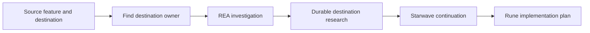

# Design: REA Feature Discovery

## Overview

Implement `rea-feature-discovery` as a portable Agent Skill around REA's existing
analysis tools and Starwave's existing planning stages. The user instructed
creation on 2026-10-26 after reviewing the requirements. This authorises the
implementation here; investigations started by the resulting skill retain their
destination's own Starwave approvals and user instructions.

## Architecture

- `claude/skills/rea-feature-discovery/SKILL.md` owns invocation, destination
  routing, investigation decisions, and Starwave handoff. It delegates analysis
  guidance to REA's advertised `investigate_feature` prompt or bundled skill
  where available, otherwise to the connected tools' schemas.
- `references/setup.md` is loaded only for missing or broken REA access. It
  explains canonical registration, scoped diagnosis, and the CLI fallback.
- `references/handoff.md` is loaded when writing or resuming destination research.
  It defines the small research record, including evidence, adaptations, open
  dependencies, approvals, and next stage.
- `agents/openai.yaml` supplies UI metadata and an invocation example, retaining
  default implicit selection. Other hosts use the portable `SKILL.md` directly.
- `mcp/servers.json` adds `rea` with the verified `rea-agents@6.7.0` stdio launcher
  for Claude, VS Code, and Codex. Existing generators and sync scripts supply the
  client-specific configuration; no proxy, daemon, or new generator is needed.

## Invocation and ownership

Input is natural language naming the source app, selected feature/question, and
destination repository; an artifact, endpoint, or existing spec can also be given.
Codex invocation is `$rea-feature-discovery`; Claude Code uses
`/rea-feature-discovery`. Missing product intent is resolved before authoring
product requirements, while supported prerequisite research can continue.

Read destination instructions, relevant agent notes, and candidate specs first.
For an existing capability, keep research with that spec. Before a new spec has
a name/owner, put research under the destination's research-document convention
(default `docs/research/rea-<capability>.md`). Do not create a research-only spec
folder that looks like a planned feature. Once Starwave creates a spec, move or
link its research without leaving competing authoritative copies.

## Evidence and continuation contract

The research record identifies source version/platform, inspected inputs, date,
selected behaviour, tool versions when relevant, and source references. Separate
user-supplied facts, observed findings, inferences, and unknowns. Preserve REA's
Evidence IDs and limitations with complete exports or retained results that can
be read without the original session; label ordinary shell or documentation
observations by their actual source.

On resume, compare source identity and available evidence with the saved record.
Do not overwrite findings from another source version. Recover unavailable
evidence or mark affected claims unresolved before using them in a planning
decision. A missing native provider does not block supported static inspection.
An installed-only mobile app does not establish access to its files.

The handoff selects behaviour to adopt and destination adaptations, then resumes
the applicable Starwave stage. A new feature enters `starwave:creating-spec`;
existing work continues from its documented stage and approval state. Preserve
acceptance-criterion IDs and follow the destination's `.agentic.json`
`decision_mode`. Blocking assumptions remain explicit dependencies rather than
implementation-ready promises. The skill ends at planning unless implementation
was separately requested.

## MCP and distribution contract

The canonical command is `npx -y rea-agents@6.7.0 mcp`, with no wildcard
`default_for` and no cloud surface. Pinning selects the upstream release; it does
not lock transitive dependency resolution or guarantee first-run offline startup.
Use `make sync-codex` for this machine's Codex registration and skill symlink;
the existing Claude skills directory link already exposes the new skill.
Other clients receive the canonical definition through the existing user/repo
generation workflow. Unrelated client settings are preserved by those writers.

Do not repair managed configs with REA's separate setup wizard. Diagnose only
the missing connection/capability; a healthy MCP transport says nothing about
source access or decompilation readiness. Keep provider installation and target
runtime actions within the user's actual task scope.

## Requirements coverage

| Acceptance criteria | Implementation |
| --- | --- |
| 1.1–1.3, 5.1 | Entry point and destination-owner selection in `SKILL.md` |
| 2.1 | Canonical REA entry, existing config writers and sync idempotence |
| 2.2–2.4 | Conditional setup reference and capability-specific recovery |
| 3.1–3.4, 5.3 | Investigation instructions and durable-evidence reference |
| 4.1–4.5, 5.2 | Handoff record and delegation to existing Starwave stages |
| 6.1 | Existing sync scripts, skill directory, and native Codex discovery |
| 6.2 | Tool roles in the entry point and setup reference |
| 6.3 | Isolated forward tests for an accessible artifact, installed-only input, and expired-session continuation |

## Validation

- Run the skill-creator validator and check reference links/UI YAML.
- Use independent forward tests with synthetic inputs in temporary workspaces;
  examine generated research and stage/ownership decisions, rather than testing
  exact wording. No real Libre account, device, or patient data is involved.
- Run `make test`, `make lint`, and native skill discovery through Codex's
  app-server API. The repository's already-missing generated Copilot file may
  need regeneration before the existing drift lint can complete.
- Run REA's production-stdio MCP doctor and confirm the new server is discoverable
  in a fresh local client. Check that a repeated sync leaves configuration bytes
  unchanged and preserves unrelated settings.
