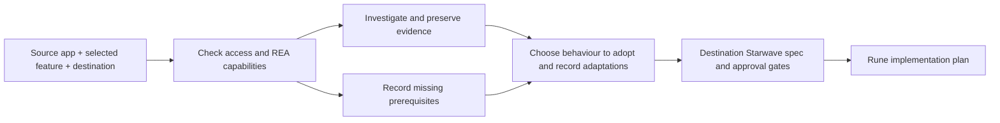

# REA Feature Discovery: Research

## Scope and ownership

This repository owns the reusable process for investigating features in existing
apps through REA and converting findings into destination-owned Starwave work.
It owns the MCP setup and shared skill instructions. The destination repository
owns the adopted feature and its research, requirements, design, decisions, and tasks.

Libre is an example of this workflow. Its target details and product-specific
context live in `medata/docs/research/libre-rea.md`; they are not the acceptance
bar for this generic feature. The `medata` repository already has
`specs/data/libre-ingestion`, `specs/data/cgm-connect`, and `specs/data/cgm-direct`.
An investigation must find the existing capability owner before creating a spec.

## Existing upstream process

[REA](https://github.com/morluto/rea/blob/main/README.md) already supplies an MCP
server and a bundled `reverse-engineer-anything` skill. The locally verified
`6.7.0` package's skill version is `42`; it covers target routing, connection
recovery, evidence limitations, and reconstruction. The new process should add
the destination-repository and Starwave handoff that this toolchain needs,
rather than duplicate REA's tool catalog or investigation instructions.

REA also exposes an
[`investigate_feature` MCP prompt](https://github.com/morluto/rea/blob/main/docs/mcp-prompts.md)
for tracing a feature into evidence. It renders investigation guidance; it does
not invoke tools itself. This is an existing entry point to reuse where the
client exposes MCP prompts, with the bundled skill and supported tool calls
available when it does not. The additional process here is the destination
selection, evidence handoff, adaptation, and Starwave planning.

REA supports several source types with different prerequisites. Static
JavaScript inspection does not need a native decompiler. Native analysis can
use providers such as Ghidra, Hopper, or IDA. An
[Apple application inventory](https://github.com/morluto/rea/blob/main/docs/apple-application-analysis.md)
uses supplied artifacts; inventory paths and framework hints do not establish
runtime behaviour. A source app's installation on a phone does not establish
that the analysis host can inspect its bytes.

The [MCP contracts](https://github.com/morluto/rea/blob/main/docs/mcp-contracts.md)
describe Evidence identities, retained session state, exports, partial results,
and error recovery. A handoff must preserve the relevant Evidence or record
that it is no longer available. A session-only identifier is insufficient for
a later, disconnected planning session.

## Verified locally on 2026-10-25

MCP DevTools `fetch_url` was used for REA's README, installation guide, Apple
application guide, and MCP contracts.
DevTools `search_packages` resolved published `rea-agents` version `6.7.0`.

- Node: `26.12.1`; npm: `11.20.0`.
- `npm exec --yes --package=rea-agents@6.7.0 -- rea --version`: exited 0.
- `rea mcp doctor --json`, using that cached package's launcher: exited 0,
  `healthy: true`, production stdio adapter, protocol `2025-11-25`.
- Initialization, exact package/catalog identity, all 207 tools, all six prompts,
  and a target-free `binary_session` call passed.
- Ghidra provider readiness: failed because `GHIDRA_INSTALL_DIR` is unset.
  Hopper and IDA were also reported unconfigured. MCP transport readiness does
  not establish native analysis readiness.
- No Libre data or app binary was accessed. No agent registration was changed.
  Package download populated npm's local cache only.
- These are host and server observations, not evidence about any source app's
  implementation or the feasibility of adopting one of its features.

## Implemented integration

Reuse REA's existing server, pin the verified package version, and keep it local.
Use this repository's canonical MCP generation to avoid a second configuration
authority. A forwarding MCP server merely renaming REA tools would add another
failure boundary without supplying the missing Starwave handoff.

The entry in `mcp/servers.json` is:

```json
{
  "rea": {
    "transport": {
      "type": "stdio",
      "command": "npx",
      "args": ["-y", "rea-agents@6.7.0", "mcp"]
    },
    "secrets": {},
    "surfaces": ["claude", "vscode", "codex"],
    "default_for": []
  }
}
```

An exact top-level package version prevents unrequested package upgrades;
it does not lock npm's transitive dependency resolution on a fresh installation.
The package-runner also needs network access on its first launch. This workflow
uses that existing package-runner pattern. Release upgrades are explicit changes
to the canonical definition and require scoped MCP/behaviour verification.

## Repository integration points

- `mcp/servers.json`: canonical server definitions. Existing generators cover
  the supported clients; commands use PATH rather than machine-specific paths.
- `scripts/generate.py`, `scripts/agentic_lib.py`, and `scripts/sync-codex.sh`:
  existing registration and merge behavior. Read callers before any changes.
- `Makefile`: use existing `make generate`, `make test`, and `make lint` for
  development checks. Unrelated in-progress changes must be preserved.
- `docs/runbooks/`: operator instructions for startup, provider readiness,
  version changes, verification, and obtaining the selected input.
- `docs/agent-notes/`: record implementation details after implementation.

## Workflow shape to validate



The prerequisite branch permits supported scoping work to continue. A missing
input is not evidence about the source implementation, and a blocked feasibility
question must not turn into an implementation-ready promise.

| Validation case | Expected result |
| --- | --- |
| Supplied Electron/JavaScript artifact | Inspect the selected behaviour with supported REA tools; preserve provenance and route findings into a destination spec without requiring a native engine. |
| Libre installed only on an iPhone | Record the inspection-input gap and available user observations in `medata`; do not invent app internals or create a Libre service in `agentic-coding`. |
| Existing destination spec with an expired-session reference | Resume its current Starwave stage, preserve requirement identifiers and decisions, identify affected downstream documents, and recover the evidence or record the affected claim as unresolved. |

## Portability and stage boundaries

- Analysis runs on the agent's local host; the inspected app may run elsewhere.
  macOS stdio is the verified baseline. Other host/provider combinations need
  their own scoped readiness result.
- Invocation must work through portable Agent Skills and existing MCP tool
  discovery. Host-specific tool names and provider versions are read from the
  running integration rather than copied into a permanent catalog.
- MCP DevTools supplies documentation and package-version research; REA supplies
  application analysis; Starwave supplies specification and planning.
- The user authorised creation on 2026-10-26 after reviewing the requirements.
  Design, rune tasks, the shared skill, and the Codex registration are now present.
  Destination investigations retain their own Starwave stage and approval state.
